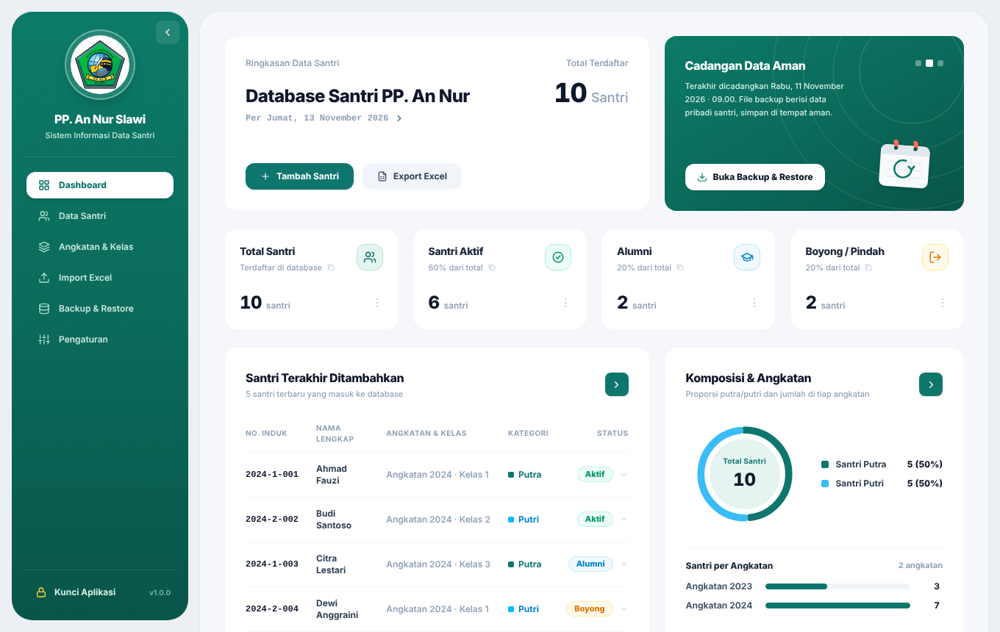
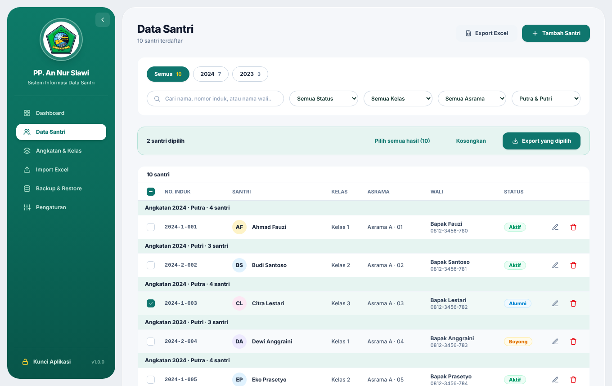
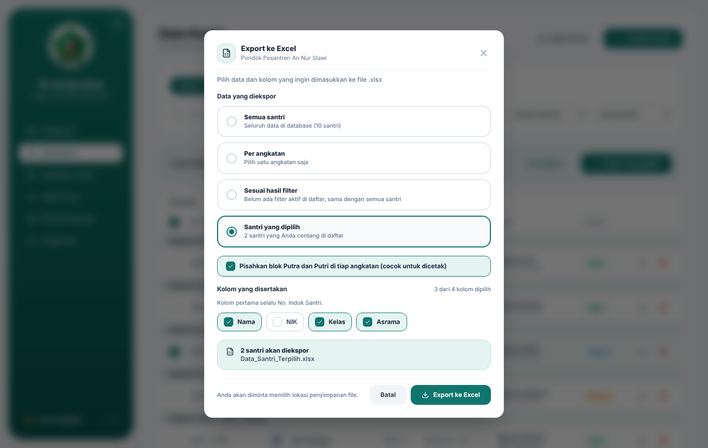
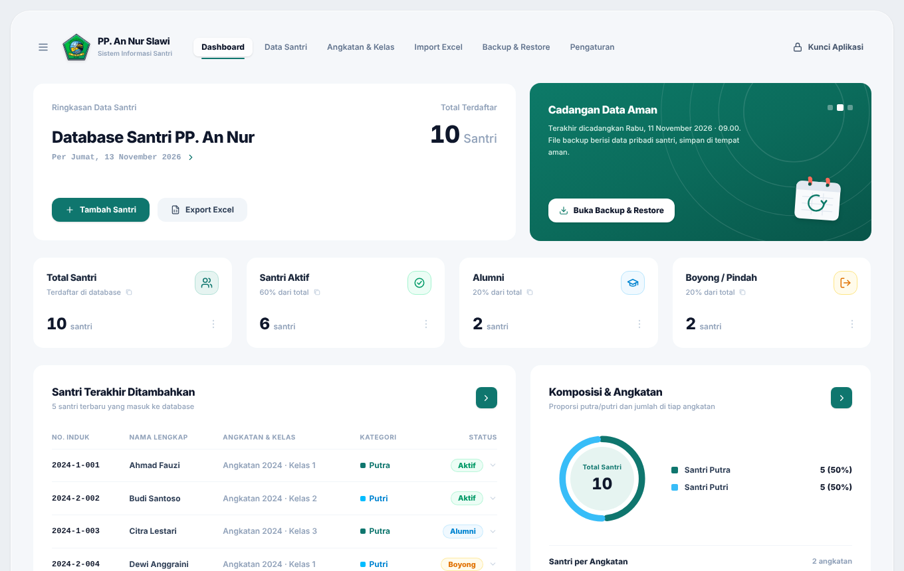
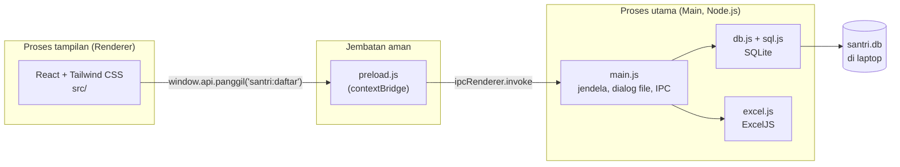

<div align="center">

# Data Santri

**Aplikasi desktop untuk mengelola data santri Pondok Pesantren An Nur Slawi**

Berjalan sepenuhnya di laptop, tanpa internet, dan dikemas menjadi file `.exe` untuk Windows.


</div>



## Tentang proyek

Selama ini data santri di pondok kami tercatat di buku dan beberapa file Excel yang terpisah-pisah. Mencari satu santri, menyiapkan data untuk lomba, atau menyerahkan data ke pengurus berikutnya selalu memakan waktu. Karena itu saya membuat **Data Santri**: satu aplikasi yang menyimpan semuanya di satu tempat, ringan, dan bisa dipakai tanpa koneksi internet.

Aplikasi ini dirancang untuk **satu pengguna di satu laptop**, jadi sederhana dipakai dan data pribadi santri tidak pernah keluar dari laptop.

## Fitur

- **Data santri lengkap:** identitas, wali, angkatan, kelas, asrama, status (Aktif, Alumni, Boyong, Pindah), catatan, dan foto (maksimal 500 KB)
- **Nomor Induk Santri otomatis** dengan format yang bisa diatur sendiri, plus tombol urutkan ulang per angkatan
- **Daftar rapi per angkatan:** dipisah blok Putra dan Putri, tiap blok urut A–Z
- **Pencarian dan filter:** nama, nomor induk, nama wali, angkatan, kelas, asrama, status, jenis kelamin
- **Export Excel:** semua santri, per angkatan, hasil filter, atau **santri tertentu yang dicentang** (berguna untuk lomba), dengan pilihan kolom
- **Import Excel** dari template, dengan pratinjau dan penanda baris bermasalah
- **Backup & Restore** satu klik (satu file `.db`), plus backup otomatis ke folder pilihan setiap aplikasi ditutup
- **Dashboard** ringkasan, dan **password opsional** dengan kode pemulihan
- **Tampilan responsif:** sidebar bisa dibuka-tutup dan otomatis berganti menjadi navbar di jendela sempit

## Tampilan

| Data Santri dengan pilihan | Export Excel |
|---|---|
|  |  |



> Gambar di atas memakai data contoh, bukan data santri sebenarnya.

## Dibangun dengan Electron

Aplikasi ini dibangun di atas **[Electron](https://www.electronjs.org/)**, kerangka kerja untuk membuat aplikasi desktop dengan teknologi web (HTML, CSS, JavaScript). Alasan saya memilihnya:

- **Satu bahasa untuk semuanya.** Tampilan (React) dan logika (Node.js) sama-sama JavaScript, sehingga mudah dirawat oleh pengurus berikutnya.
- **Jadi aplikasi Windows sungguhan.** Hasilnya file `.exe` yang bisa dipasang atau dijalankan dari flashdisk, lengkap dengan ikon, dialog simpan/buka file, dan jendela sendiri.
- **Akses file di laptop.** Data disimpan di satu file lokal, dan backup serta Excel bisa ditulis langsung ke folder pilihan.
- **Tampilan modern.** Antarmuka dibuat dengan React dan Tailwind CSS tanpa keterbatasan tampilan desktop klasik.

### Arsitektur

Electron membagi aplikasi menjadi dua proses yang berkomunikasi lewat IPC:



- **Renderer (`src/`)** hanya mengurus tampilan dan tidak punya akses langsung ke file atau sistem.
- **Preload (`electron/preload.js`)** hanya meneruskan saluran IPC yang namanya sesuai pola yang diizinkan.
- **Main (`electron/`)** menjalankan semua aturan data: database, nomor induk, Excel, backup.

Pengaturan keamanan Electron yang dipakai: `contextIsolation` aktif, `nodeIntegration` mati, `sandbox` aktif, dan ada Content-Security-Policy yang menolak sumber dari luar. Aplikasi juga menolak membuka jendela atau halaman ke alamat internet.

## Teknologi

| Bagian | Teknologi |
|---|---|
| Kerangka desktop | Electron |
| Tampilan | React 18, Vite, Tailwind CSS 3, font Plus Jakarta Sans (dibundel) |
| Database | SQLite lewat sql.js (WebAssembly), disimpan di satu file `santri.db` |
| Excel | ExcelJS |
| Pengemasan | electron-builder (installer NSIS dan versi portable) |
| Build otomatis | GitHub Actions |

## Menjalankan di komputer sendiri

Butuh [Node.js](https://nodejs.org/) 22 LTS.

```bash
git clone https://github.com/NAMAANDA/NAMA-REPO.git
cd NAMA-REPO
npm install

npm run dev      # mode pengembangan dengan live reload
npm run start    # build tampilan lalu buka aplikasi
```

## Membuat file .exe

**Di laptop Windows:**

```bash
npm run dist
```

Hasilnya ada di folder `release/`: `DataSantri-Setup-x.x.x.exe` (installer) dan `DataSantri-Portable-x.x.x.exe` (bisa dijalankan dari flashdisk).

**Lewat GitHub Actions:** buka tab **Actions**, pilih **Build Data Santri (Windows)**, lalu **Run workflow**. Build juga berjalan otomatis setiap ada tag versi, misalnya `v1.0.0`. Hasilnya diunduh dari bagian **Artifacts**.

> File `.exe` ini belum bertanda tangan digital, jadi Windows bisa menampilkan peringatan SmartScreen. Klik **More info**, lalu **Run anyway**.

## Struktur proyek

```
electron/
  main.js      proses utama: jendela, dialog file, saluran IPC, backup otomatis
  preload.js   jembatan aman ke tampilan
  db.js        operasi database dan aturan data
  nis.js       format dan urutan nomor induk santri
  excel.js     export, template, dan pembacaan file impor
  skema.js     skema tabel SQLite
src/
  App.jsx      kerangka, sidebar/navbar, kunci aplikasi
  ui.jsx       komponen dasar (tombol, dialog, toast, ikon, logo)
  halaman/     Dashboard, Data Santri, Form, Export, Import, Backup, Pengaturan
docs/          panduan teknis dan gambar
build/         ikon aplikasi
```


